<div align="center">

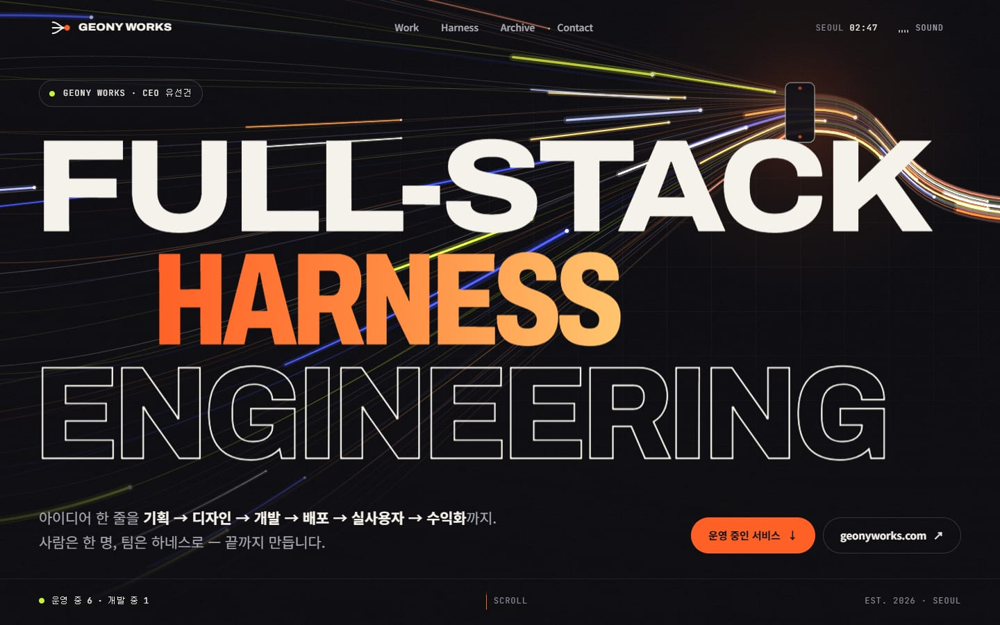

# 유선건 · GEONY WORKS — Portfolio

**아이디어 한 줄을 기획 → 디자인 → 개발 → 배포 → 실사용자 → 수익화까지.**<br>
거니웍스(GEONY WORKS) 대표 유선건의 포트폴리오. 2020년 jQuery로 만든 포트폴리오를 처음부터 다시 지었습니다.

[**tjsrjs8282.github.io/portfolio**](https://tjsrjs8282.github.io/portfolio/) · [2020 버전](https://tjsrjs8282.github.io/portfolio/legacy/) · [geonyworks.com](https://geonyworks.com)


</div>

---

## Before → After

| | 2020 (원본, `legacy/`) | 2026 (지금) |
|---|---|---|
| 포지션 | Web Designer & Publisher | 거니웍스 대표 · Full-stack Harness Engineering |
| 스택 | HTML 한 장 + jQuery 3.4 + Font Awesome | Astro 7 · TypeScript · GSAP · Lenis · Canvas 2D · Web Audio |
| 작업 | 2020년 작업 9개 | 직접 운영하는 서비스 6개 + 개발 중인 클라이언트 1개 + 2020 아카이브 |
| 첫 로드 | 9.2 MB (작업 이미지 하나에 1~1.5 MB, 자동재생 MP3) | **311 KB** (AVIF · 반응형 srcset · 글꼴 서브셋) |
| 한글 글꼴 | — | 페이지에 쓰인 394자만 담은 Noto Sans KR 1개 파일(71 KB) |
| 사운드 | 자동재생 MP3 | 누를 때만 받는 오리지널 UI 사운드 + 앰비언트 루프 |
| 접근성 | `div` 버튼, 키보드 불가, 확대 금지 | 랜드마크 · 스킵 링크 · 네이티브 `dialog` · 키보드 슬라이더 · 모션 줄이기 |
| 개인정보 | 생일 · 집 주소 · 전화번호 공개 | 연락은 이메일 · 거니웍스 문의로만 (`legacy/`에서도 가림) |
| 문의 폼 | `mail.php` — Pages에서 PHP가 돌지 않아 동작 안 함 | geonyworks.com 문의 · 카카오톡 채널 · 이메일 |

**Lighthouse 13** (2026-10-31 · 2026은 배포된 라이브 주소, 2020은 같은 파일을 로컬에서 측정)

| | Performance | Accessibility | Best Practices | SEO |
|---|---|---|---|---|
| 2020 · 데스크톱 | 75 | 70 | 92 | 91 |
| **2026 · 데스크톱** | **100** (LCP 0.6 s · CLS 0) | **100** | **100** | **100** |
| 2020 · 모바일 | 71 (LCP 38.9 s) | 77 | 92 | 91 |
| **2026 · 모바일** | **86** (LCP 1.6 s · CLS 0) | **100** | **100** | **100** |

<table>
  <tr>
    <td width="50%">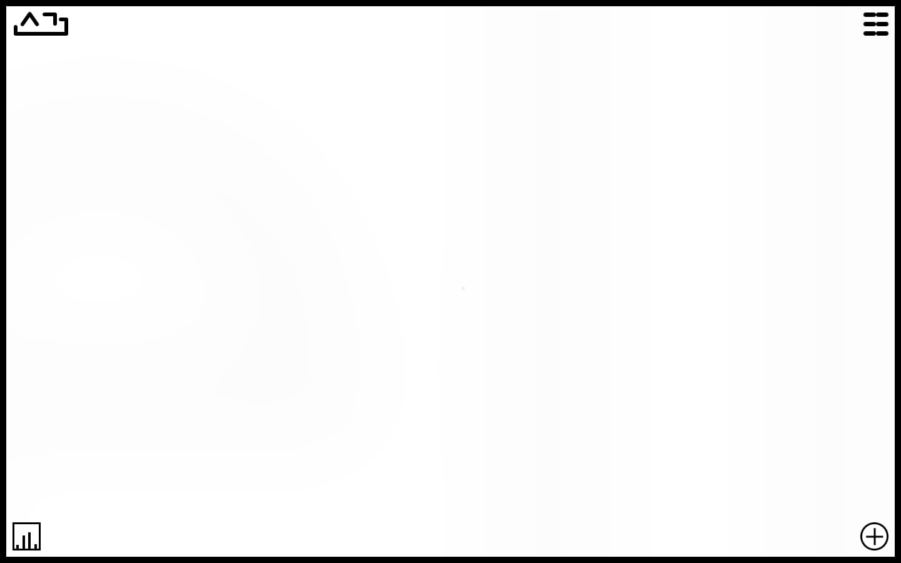<br><sub>2020 · 첫 화면</sub></td>
    <td width="50%"><br><sub>2026 · 히어로 — 하네스 캔버스</sub></td>
  </tr>
  <tr>
    <td>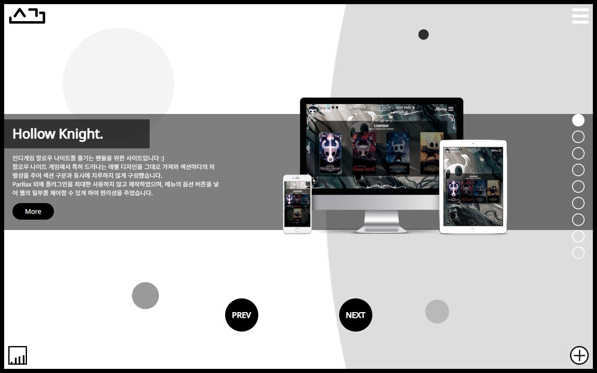<br><sub>2020 · Work</sub></td>
    <td>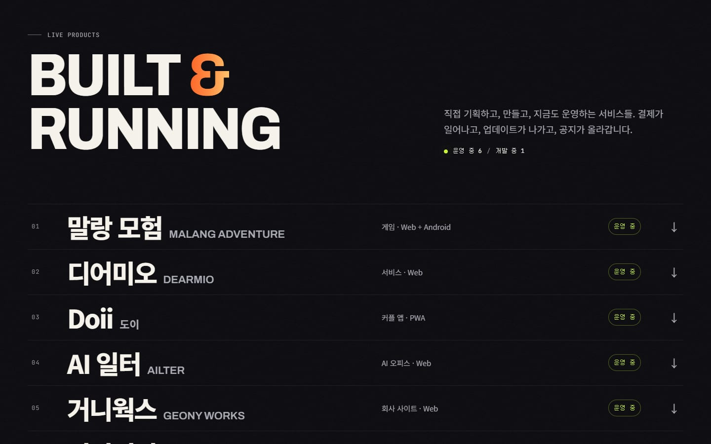<br><sub>2026 · 운영 중인 서비스 인덱스</sub></td>
  </tr>
  <tr>
    <td>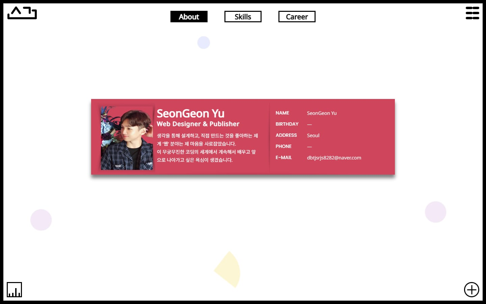<br><sub>2020 · About (생일 · 주소 · 전화번호는 가림)</sub></td>
    <td>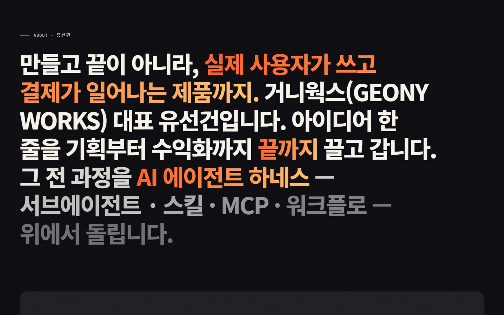<br><sub>2026 · 스크롤로 켜지는 소개</sub></td>
  </tr>
</table>

<table>
  <tr>
    <td width="50%">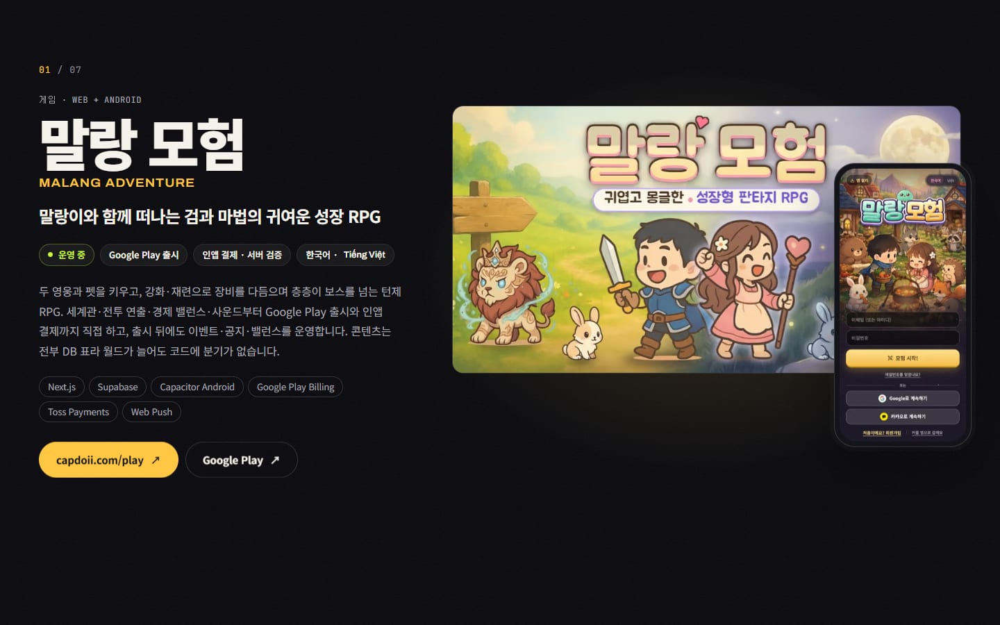<br><sub>서비스 챕터 — 말랑 모험</sub></td>
    <td width="50%">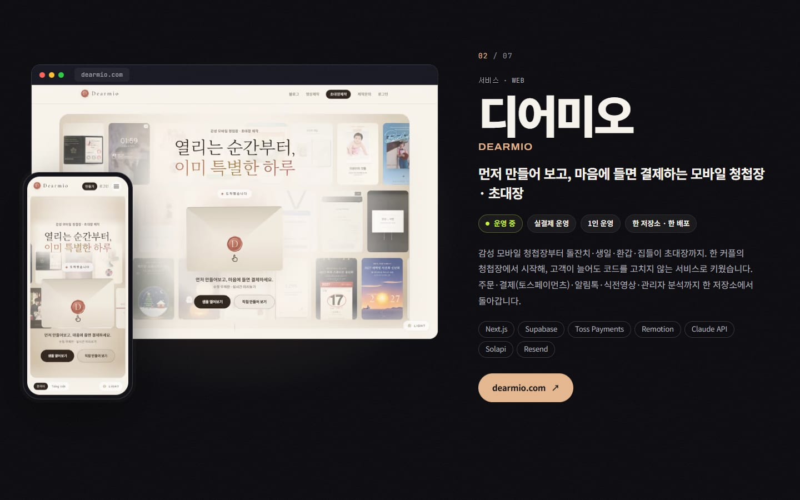<br><sub>서비스 챕터 — 디어미오</sub></td>
  </tr>
  <tr>
    <td>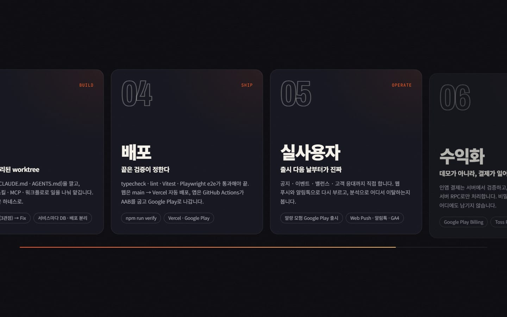<br><sub>Idea → Revenue — 고정된 가로 스크롤</sub></td>
    <td>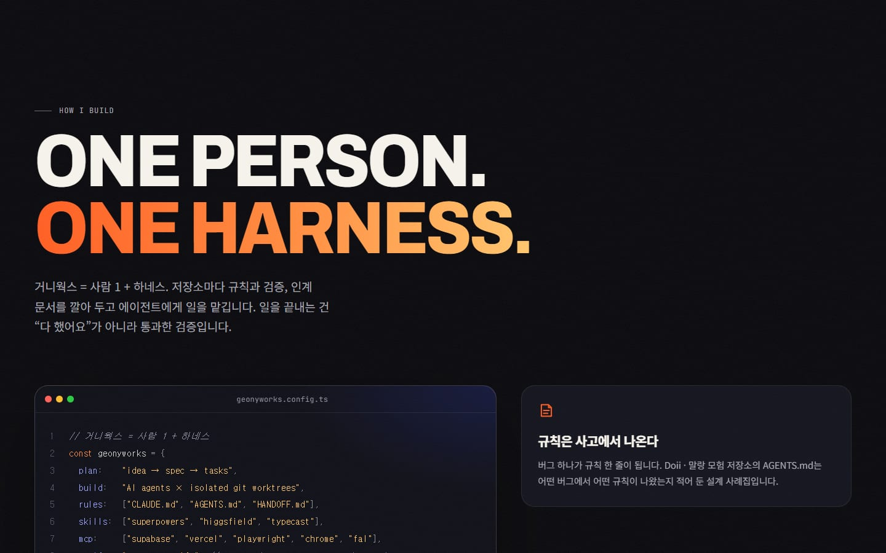<br><sub>일하는 방식 — 하네스 구성 코드와 원칙</sub></td>
  </tr>
  <tr>
    <td>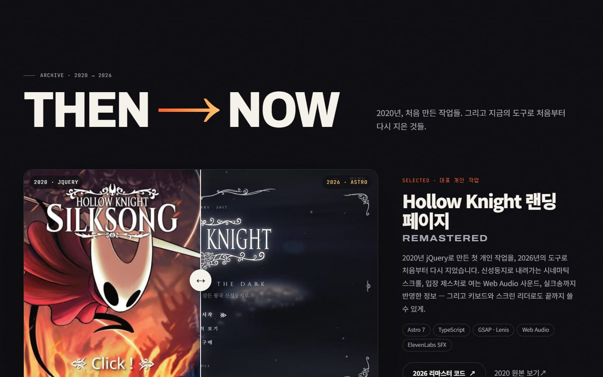<br><sub>Then → Now — 2020/2026 비교 슬라이더</sub></td>
    <td>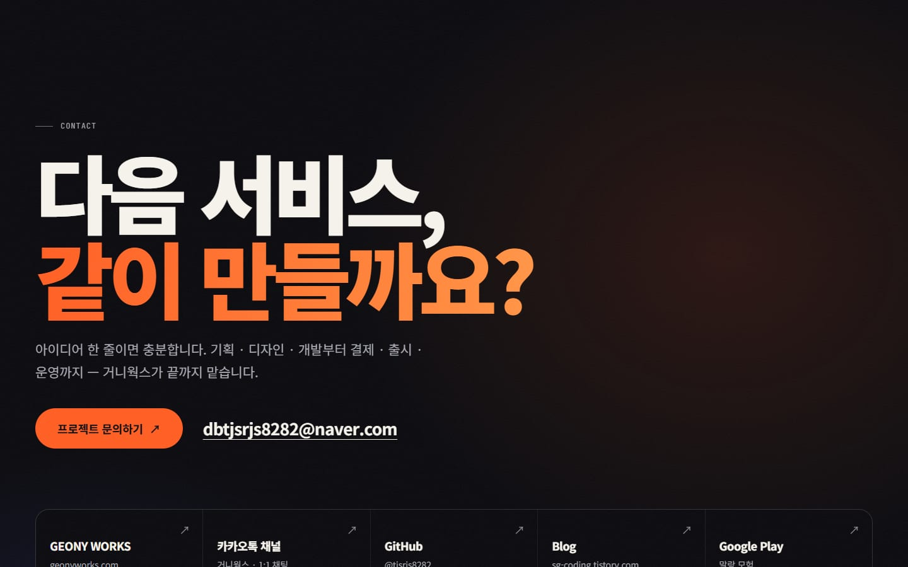<br><sub>연락하기</sub></td>
  </tr>
</table>

<table>
  <tr>
    <td width="25%">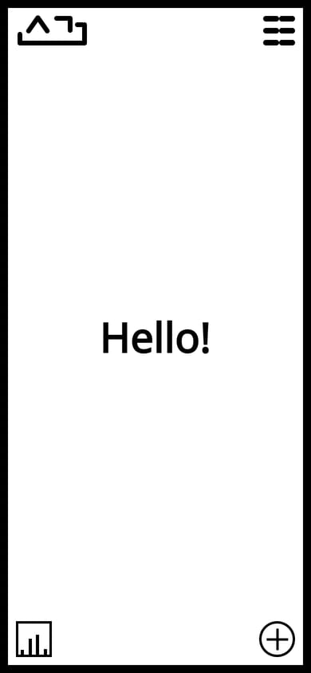<br><sub>2020 · 모바일</sub></td>
    <td width="25%">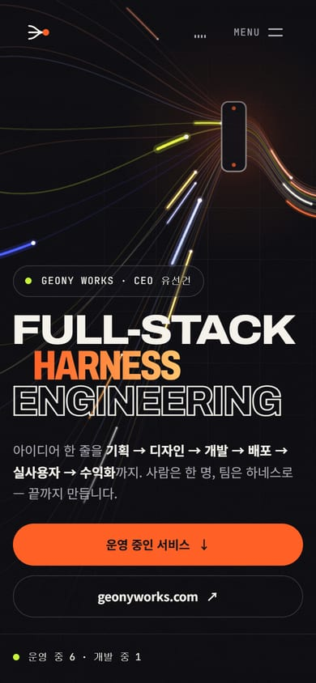<br><sub>2026 · 모바일</sub></td>
    <td width="25%">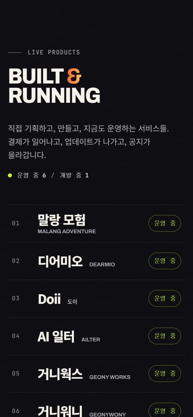<br><sub>서비스 목록</sub></td>
    <td width="25%">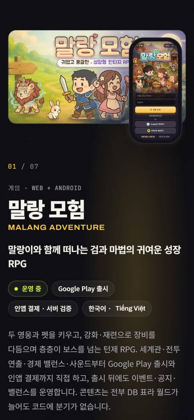<br><sub>서비스 챕터</sub></td>
  </tr>
</table>

---

## 페이지 구성

| 섹션 | 내용 |
|---|---|
| **Hero** | 폭(`wdth`)과 굵기가 바뀌는 가변 글꼴 Archivo로 쓴 `FULL-STACK / HARNESS / ENGINEERING`. 뒤에서는 Canvas 2D로 그린 **하네스**가 움직입니다 — 왼쪽의 느슨한 케이블들이 클램프 하나를 지나 한 다발로 나가고, 빛이 지나갈 때마다 클램프가 달아오릅니다. 마우스가 케이블을 끌어당기고, 스크롤하면 팽팽해집니다. |
| **About** | 프로필 README와 같은 문장. 스크롤에 맞춰 단어가 하나씩 켜집니다. |
| **Process** | 기획 → 디자인 → 개발 → 배포 → 실사용자 → 수익화. 데스크톱에서는 화면에 고정된 채 가로로 흐르고, 모바일 · 모션 줄이기에서는 그냥 쌓입니다. |
| **Work** | 커서를 따라오는 미리보기가 붙은 인덱스와, 서비스마다 브라우저 · 폰 프레임에 담긴 실제 화면. |
| **Harness** | 저장소마다 까는 규칙 · 검증 · 인계를 코드 한 장과 원칙 네 개로. |
| **Toolbox** | 매일 쓰는 도구들이 흐르는 마키. |
| **Archive** | Hollow Knight 랜딩 페이지 · ZINI 브랜드 사이트의 2020/2026 비교 슬라이더(키보드로도 조작), 이 사이트의 2020 버전, 2020년 작업들. |
| **Path** | 사진 · 시공 → 웹디자인 → 웹 에이전시 → 엔지니어 → 거니웍스 개업 → 출시와 실결제. |
| **Contact** | 거니웍스 문의 · 카카오톡 채널 · 이메일 · GitHub · 블로그 · Google Play. |

### 실린 서비스

[거니웍스 HQ](https://app.notion.com/p/409f67e4fb1981a29257ff51f0a3d3d7) 노션 페이지의 **운영 중** 목록과 같고, 문구는 각 서비스의 실제 사이트 · 저장소 README · [GitHub 프로필](https://github.com/tjsrjs8282)에서 가져왔습니다. 사용자 수 · 매출 같은 수치는 넣지 않았습니다. 숫자는 프로필 README에 있는 커밋 · 마이그레이션 수(2026-10 기준)뿐입니다.

| | 서비스 | 링크 | 상태 |
|---|---|---|---|
| 01 | 말랑 모험 — 성장 RPG | [capdoii.com/play](https://capdoii.com/play) · [Google Play](https://play.google.com/store/apps/details?id=com.geonyworks.mallangadventure) | 운영 중 |
| 02 | 디어미오 — 모바일 청첩장 · 초대장 | [dearmio.com](https://dearmio.com) | 운영 중 |
| 03 | Doii — 한·베 커플 앱 | [capdoii.com](https://capdoii.com) | 운영 중 |
| 04 | AI 일터 — AI 오피스 | [ailter.ai](https://ailter.ai) | 운영 중 |
| 05 | 거니웍스 — 회사 사이트 · 고객 포털 | [geonyworks.com](https://geonyworks.com) | 운영 중 |
| 06 | 거니워니 — 한베커플 공식 홈 | [geonywony.com](https://geonywony.com) | 운영 중 |
| 07 | 크리에이커 — 클라이언트 사이트 리뉴얼 | [creakor.net](https://creakor.net) | 개발 중 |

서비스 화면은 `npm run capture`로 각 라이브 사이트에서 직접 찍은 것이고, 말랑 모험과 Doii의 큰 그림은 각 서비스의 공식 OG 이미지입니다. 크리에이커는 아직 오픈 전이라 화면 대신 진행 상황만 보여 줍니다.

---

## 만든 방식

- **정적 사이트, 키 없음** — 모든 페이지는 빌드 때 HTML로 굳습니다. API 키는 브라우저로 가지 않고, `.env.local`의 키는 사운드를 만드는 빌드 스크립트만 씁니다.
- **글꼴** — Astro Fonts API로 직접 호스팅합니다. 한글은 `src/`의 모든 글자(+ ASCII)를 모아 Google `text=` 서브셋으로 받아 **변수 글꼴 1개(71 KB)** 만 내려보냅니다. 유니코드 조각 120여 개(3.8 MB)가 차례로 도착하며 화면을 다시 그리는 일이 없습니다. 베트남어(`Tiếng Việt`)는 `lang="vi"`로 표시하고 Archivo의 베트남어 서브셋으로 씁니다.
- **모션** — Lenis 스무스 스크롤 + GSAP ScrollTrigger. 첫 화면 밖의 연출은 `requestIdleCallback` 큐에서 섹션 순서대로 작은 작업으로 나눠 붙이고, 마지막에 한 번 정렬 · 측정합니다. 캔버스는 화면 밖이거나 탭이 숨으면 멈춥니다.
- **모션 줄이기** — `prefers-reduced-motion`이면 Lenis · 고정 스크롤 · 스크럽 · 마키가 모두 꺼지고, 캔버스는 정지 화면 한 장만 그립니다. JS가 없어도 모든 내용이 보입니다.
- **접근성** — 랜드마크 · 스킵 링크 · 앵커 이동 시 포커스 이동 · 네이티브 `<dialog>` 메뉴(Esc, 포커스 복귀, `data-lenis-prevent`) · `input[type=range]` 비교 슬라이더 · 장식 텍스트는 `aria-hidden` + 스크린 리더용 문장 · 흐린 단어도 3.8:1 대비.
- **사운드** — ElevenLabs로 만든 UI 사운드 4개와 48초 앰비언트 루프(ffmpeg로 마스터링 · 이음매 크로스페이드). Sound 버튼을 누르기 전에는 한 바이트도 받지 않습니다.
- **OG 이미지** — 실제 히어로를 1200×630으로 렌더링한 것(`npm run assets:og`).
- **2020 버전** — `legacy/`에 그대로 두고 빌드 때 `/portfolio/legacy/`로 복사합니다. 바뀐 것은 생일 · 집 주소 · 전화번호 세 줄을 가린 것뿐이고(되돌리려면 해당 커밋을 revert), Pages에서 돌지 않는 `mail.php`는 배포하지 않습니다.

---

## 개발

```bash
npm install
npm run dev          # http://localhost:4321/portfolio/
npm run build        # dist/ (+ dist/legacy/)
npm run preview      # http://localhost:4330/portfolio/
npm run check        # astro check (타입)
```

에셋 스크립트 (빌드에는 필요 없고, 다시 만들 때만):

```bash
npm run capture        # 라이브 서비스 화면 → src/assets/shots/
npm run assets:sound   # ElevenLabs → public/sound/ (.env.local의 ELEVENLABS_API_KEY)
npm run assets:og      # 실제 히어로 → public/og.jpg (preview 서버 필요)
npm run shots          # README 스크린샷 → docs/screenshots/ (preview 서버 필요)
```

`.env.example`을 `.env.local`로 복사해 키를 채웁니다. `.env.local`은 커밋되지 않습니다.

## 배포

`master`에 푸시하면 [`.github/workflows/deploy.yml`](.github/workflows/deploy.yml)이 `astro check` → `astro build` 후 GitHub Pages로 올립니다(Pages 소스: **GitHub Actions**). Actions 탭에서 손으로 다시 돌릴 수도 있습니다(`workflow_dispatch`).

Vercel에도 Git 연동으로 올라갑니다(`master` → Production). Pages는 사이트를 `/portfolio/` 아래에, Vercel은 도메인 루트에 두므로 Vercel 빌드(`VERCEL=1`)에서는 `astro.config.mjs`가 `base`를 `/`로, `site`를 `VERCEL_PROJECT_PRODUCTION_URL`로 바꿉니다. `site.webmanifest`는 상대 경로라 양쪽에서 그대로 맞습니다.

```
src/
  components/   Hero · Manifesto · Pipeline · Products · Harness · Toolbox · Archive · Path · Contact …
  data/         site.ts (문구 · 연혁) · products.ts (서비스 7개)
  scripts/      app.ts (스크롤 · 모션) · harness.ts (캔버스) · sound.ts (Web Audio)
  assets/       shots/ (라이브 화면) · og/ (서비스 OG) · archive/ (2020 · Hollow Knight · ZINI)
legacy/         2020년 원본
scripts/        capture · sound · og · shots
```

<sub>Hollow Knight는 Team Cherry의 게임이며, 비교 슬라이더의 화면은 그 게임을 소재로 만든 개인 작업(랜딩 페이지)입니다. ZINI는 케어앤셰어의 캐릭터 콘돔 브랜드이며, 그 브랜드 사이트를 소재로 다시 만든 리디자인 작업물입니다. 서비스 화면과 OG 이미지는 모두 거니웍스가 만들고 운영하는 서비스의 것입니다.</sub>
